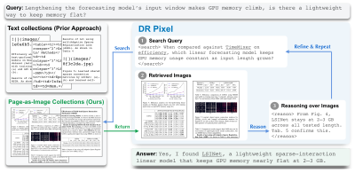

<h1 align="center">
  <picture>
    <source media="(prefers-color-scheme: dark)" srcset="docs/assets/logo-dark.svg">
    
  </picture>
  DR Pixel: Page-Native Deep Research<br>with Vision-Language Models
</h1>
<!-- Link the title to the arXiv page once it is public. -->

<p align="center">
  Tiansheng Hu<sup>N</sup>,
  Yichuan Wang<sup>B</sup>,
  James V. Talwar<sup>R</sup>,
  Nicholas Tomlin<sup>T</sup>,
  Chen Zhao<sup>NY</sup>,
  Sewon Min<sup>B</sup>
</p>
<p align="center"><sub>
  <sup>N</sup>NYU Shanghai &nbsp;
  <sup>B</sup>University of California, Berkeley &nbsp;
  <sup>R</sup>Rational Dynamics &nbsp;
  <sup>T</sup>Toyota Technological Institute at Chicago &nbsp;
  <sup>NY</sup>New York University
</sub></p>

<p align="center">
  <a href="https://github.com/HughieHu/DRPixel/actions/workflows/ci.yml"></a>
  <a href="https://huggingface.co/datasets/HughieHu/drpixel-bench"></a>
  
</p>

<p align="center">
  <a href="#what-it-is">What it is</a> &middot;
  <a href="#how-it-works">How it works</a> &middot;
  <a href="#evaluate-your-model">Evaluate</a> &middot;
  <a href="#data">Data</a> &middot;
  <a href="#training">Training</a> &middot;
  <a href="#citation">Citation</a>
</p>

---

```bash
git clone https://github.com/HughieHu/DRPixel && cd DRPixel/eval
pip install -e '.[client]'

export MODEL_NAME=gpt-4o MODEL_BASE_URL=https://api.openai.com/v1 MODEL_API_KEY=sk-...
export SEARCH_URL=...          # the search endpoint, see eval/README.md
export JUDGE_API_KEY=sk-...    # for the gpt-5.4-mini judge

python -m drbench.doctor                # about 20 s: checks the model, the search endpoint and image input
python -m drbench.eval --config Page    # runs and grades all 500 questions
```

## What it is

Deep research agents usually work on documents only after OCR has turned them into text, and that
conversion loses or corrupts much of what matters in a scientific paper: tables, figures and
equations. DR Pixel is a page-native deep research agent. It renders each paper page by page,
retrieves page images with a vision-language embedding model, and reasons over the images
directly, so the text and visual content of a page are retrieved and read together.

This repository contains the code for the paper:

| | |
|---|---|
| [`eval/`](eval/) | the evaluation harness for DRPixelBench, 500 questions over 1.06M pages from 99,055 scientific papers. Point it at any OpenAI-compatible model and one command runs and grades it. |
| [`train/`](train/) | data preparation and training for counterfactual credit reweighting, the SFT recipe behind the trained DR Pixel model. |

## How it works

<p align="center">
  
</p>

The agent runs a ReAct loop. At each turn it writes a thought and then either searches or gives its
final answer. Search results stay in context, and each question allows at most 20 searches. The
settings differ only in what the search tool returns. DR Pixel searches 1,062,153 page images,
rendered at 150 dpi and embedded with Qwen3-VL-Embedding-8B, and gets back the top three pages.
The OCR-based baselines in the paper search the same papers after parsing them into text:

| `--config` | what the agent searches | needs vision |
|---|---|---|
| `Page` | whole-page images, top 3 (DR Pixel) | yes |
| `Text` | 256-word OCR chunks, top 5, embedded with Qwen3-Embedding-8B | no |
| `Text_Fig` | the same chunks, plus a second tool that searches cropped figures | yes |

To train an open-weight model, we fine-tune Qwen3.6-27B on GPT-5.4 trajectories. Standard SFT
imitates every teacher step, including repeated or low-value searches, and the student learns to
search too much. Counterfactual credit reweighting instead scores each reasoning and search step by
how much it changes the frozen base model's likelihood of the gold answer, turns these scores into
per-step loss weights, and trains on the weighted data with ordinary SFT.

## Evaluate your model

Any endpoint that speaks the OpenAI chat-completions API works, hosted or local. For any other API,
subclass `Client` and override `complete()` in [`eval/drbench/model.py`](eval/drbench/model.py),
which is the only code that talks to the model.

[`eval/README.md`](eval/README.md) covers setup, the search server, grading, the output files and
reproducibility. Keep two conventions in mind when comparing numbers:

- Every question is grounded in exactly one gold page. PgHit is the share of questions whose gold
  page was retrieved; under `Text` it is not measurable, because a text chunk carries no page
  number.
- Acc|Pg is accuracy on the questions whose gold page was retrieved, and Tool/q counts searches
  only, not the final answer.

## Data

Everything is in one HuggingFace dataset,
[`HughieHu/drpixel-bench`](https://huggingface.co/datasets/HughieHu/drpixel-bench):

| | |
|---|---|
| `benchmark/` | the 500 questions |
| `corpus/` | the list of all 99,055 papers, their OCR text, and all 1,062,153 page images (473 GB), rendered exactly as the agent sees them |
| `index/` | the page and passage embedding indices (8.7 GB and 36 GB) |

The corpus combines papers we collected from arXiv and open-access conference proceedings with the
papers of AirQA, IRPapers and M3SciQA, so that all four benchmarks share one corpus. The 13,946
papers that come from those benchmarks remain under their original releases. We do not
redistribute PDFs; `corpus/papers.jsonl` gives an arXiv id for 76.3% of the corpus.

## Training

The trained model is released as
[`HughieHu/DR-Pixel-Trained`](https://huggingface.co/HughieHu/DR-Pixel-Trained), and its training set,
2,496 GPT-5.4 trajectories with their per-step weights and raw credits, in the `train/` directory of
[`HughieHu/drpixel-bench`](https://huggingface.co/datasets/HughieHu/drpixel-bench#training-data-train).
[`train/README.md`](train/README.md) shows how to train on it and describes the data-preparation
steps, from scoring each step's credit to writing the training file, the small ms-swift plugin that
applies the weights, and the training recipe.

## Citation

```bibtex
@misc{hu2026drpixel,
  title  = {DR Pixel: Page-Native Deep Research with Vision-Language Models},
  author = {Hu, Tiansheng and Wang, Yichuan and Talwar, James V. and Tomlin, Nicholas and Zhao, Chen and Min, Sewon},
  year   = {2026}
}
```

## License

The code is released under [Apache-2.0](LICENSE). For the data, see the dataset cards on
HuggingFace; papers from the external benchmarks remain under the terms of their original releases.
